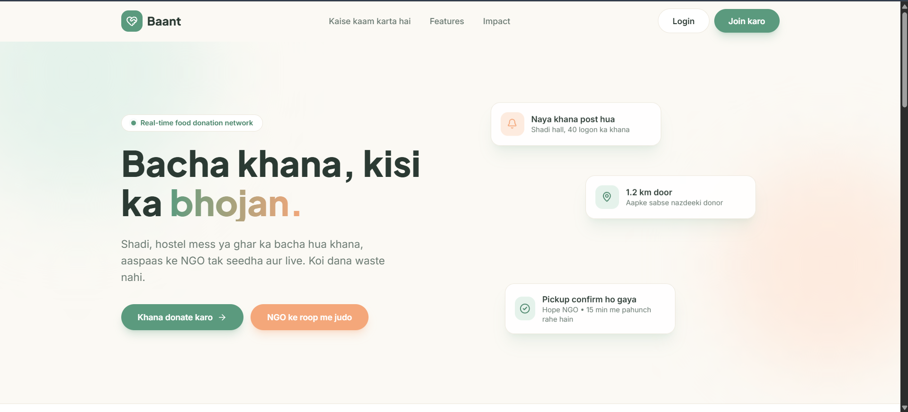
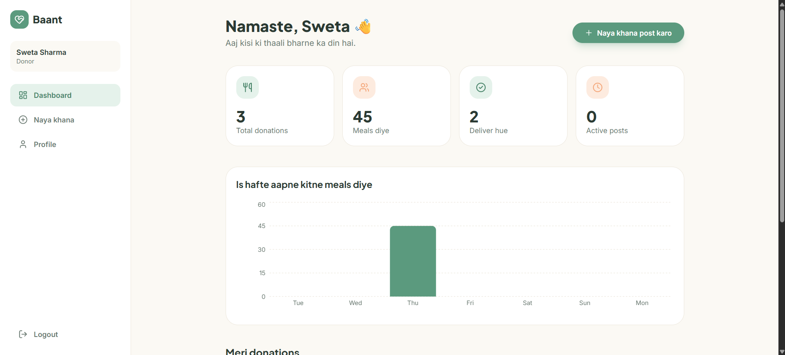
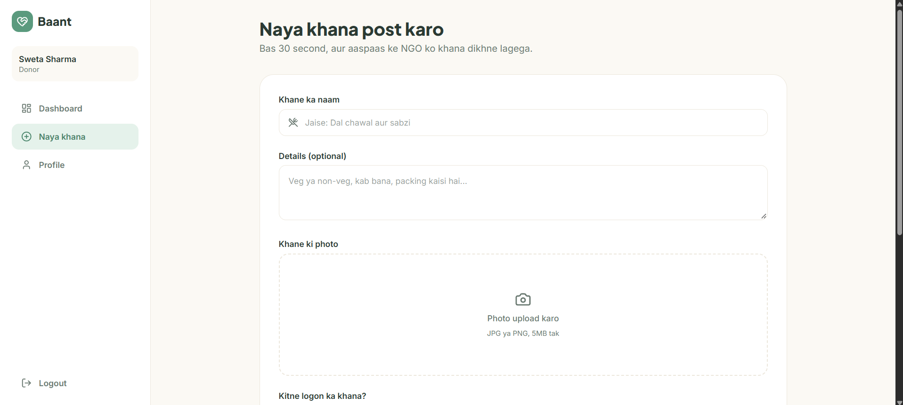
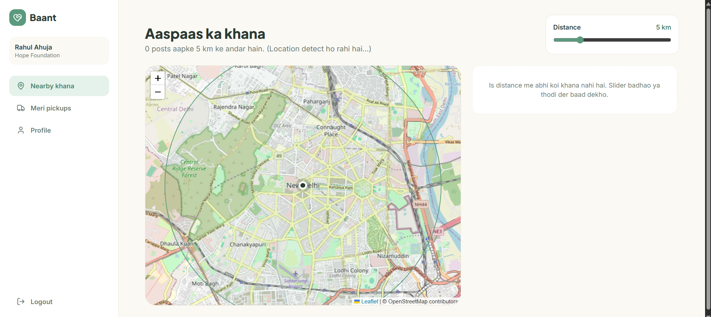
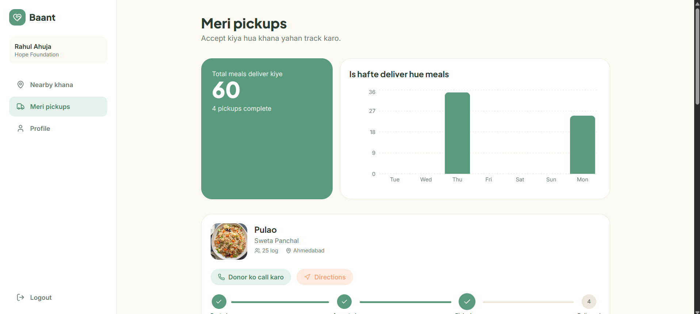
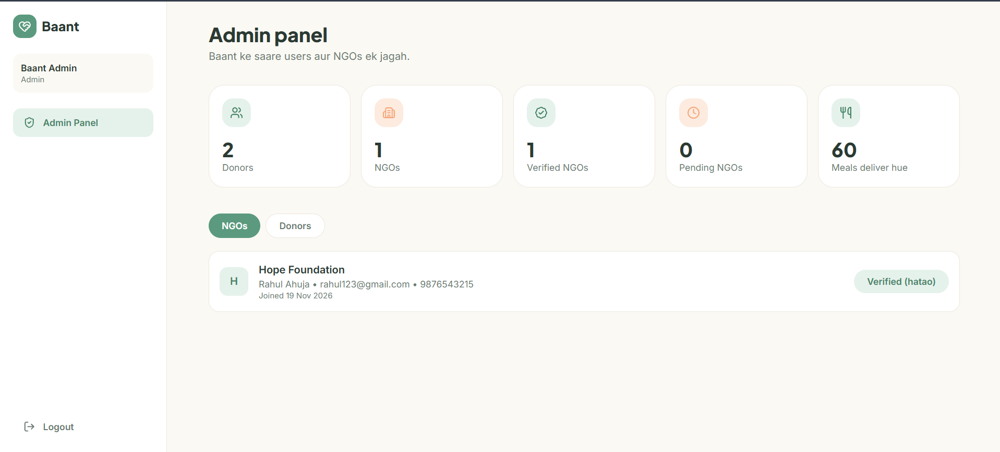

# Baant 🤝

**Khana baanto, khushiyan badhao.**
Baant ek real-time food donation platform hai jo bacha hua khana (shadi, hostel mess, ghar, canteen) aaspaas ke verified NGOs tak pahunchata hai.

> **Live demo:** [https://baant-mern.vercel.app](https://baant-mern.vercel.app)
>
> Backend free tier par hai, isliye pehli baar kholne par 30-50 second lag sakte hain.

## Problem

Bahut sa khana roz waste hota hai, jabki kai logon ko khana nahi milta. Donor ko pata nahi hota ki kaun le jayega, aur NGO ko pata nahi hota ki khana kahan available hai. Baant dono ko live jodta hai.

## Screenshots

| Landing | Donor Dashboard |
|---|---|
|  |  |

| Naya khana post karo | NGO Nearby Map |
|---|---|
|  |  |

| Pickup Tracking | Admin Panel |
|---|---|
|  |  |

## Features

**Donor**
- Khana post karo: photo, quantity, expiry time, location
- Live status: NGO accept kare to turant notification
- Dashboard me stats aur weekly chart

**NGO**
- Map aur list me aaspaas ka khana (distance slider)
- Naya post aate hi bina refresh ke live card aur toast
- Accept, Pickup, Deliver tracking, donor ko call aur Google Maps directions

**Admin**
- NGOs ko verify karna (sirf verified NGO hi khana accept kar sakta hai)
- Users aur platform stats

**Common**
- Email/password aur Google login
- Role-based access (Donor, NGO, Admin)
- Expire hue khane ko auto-mark karne wala cron job
- Profile page, password change

## Tech Stack

| Layer | Tech |
|---|---|
| Frontend | React (Vite), Tailwind CSS, Framer Motion, React Router, Leaflet, Recharts |
| Backend | Node.js, Express |
| Database | MongoDB Atlas, Mongoose |
| Real-time | Socket.io |
| Auth | JWT, bcrypt, Google OAuth |
| Jobs | node-cron |
| Security | helmet, express-rate-limit |

## Kuch Technical Highlights

- **Geospatial search:** MongoDB `2dsphere` index aur `$near` query se nearby khana, distance ke hisab se sorted.
- **Race condition safe accept:** `findOneAndUpdate` me `status: "available"` condition hai, to do NGO ek saath accept dabayein to sirf ek ko milta hai.
- **Backend role security:** `protect` aur `authorize` middleware har API pe token aur role check karte hain, frontend ka redirect sirf UI ke liye hai.
- **Socket.io rooms:** Har user `user:<id>` aur `role:<role>` room me jata hai, aur socket connection bhi JWT se verify hota hai. Donor ka phone number sirf uske apne events me jata hai.
- **Photo compression:** Upload se pehle browser me photo chhoti ki jati hai, taaki DB aur network halka rahe.
- **Auto-expire:** Cron job har minute expired posts ko `expired` mark karke live event bhejta hai.

## Folder Structure

```
Baant/
├── client/          # React frontend
│   └── src/
│       ├── components/   # UI components
│       ├── pages/        # donor, ngo, admin, auth pages
│       ├── context/      # AuthContext
│       ├── services/     # API aur socket calls
│       └── hooks/
├── server/          # Express backend
│   ├── controllers/
│   ├── models/
│   ├── routes/
│   ├── middleware/
│   ├── jobs/        # cron
│   └── socket.js
└── screenshots/
```

## Local Setup

**Requirements:** Node.js, MongoDB Atlas account, Google OAuth Client ID

```bash
git clone https://github.com/swetapanchal-244/Baant-MERN.git
cd Baant-MERN
```

**Server**
```bash
cd server
npm install
```
`server/.env` banao:
```
PORT=5000
MONGO_URI=your_mongodb_connection_string
JWT_SECRET=your_long_random_secret
CLIENT_URL=http://localhost:5173
GOOGLE_CLIENT_ID=your_google_client_id
```
```bash
npm run dev
```

**Client**
```bash
cd client
npm install
```
`client/.env` banao:
```
VITE_API_URL=http://localhost:5000/api
VITE_GOOGLE_CLIENT_ID=your_google_client_id
```
```bash
npm run dev
```

**Admin account banana**
```bash
cd server
node scripts/createAdmin.js admin@example.com yourPassword
```

## API Overview

| Method | Endpoint | Access |
|---|---|---|
| POST | `/api/auth/register`, `/login`, `/google` | Public |
| GET/PUT | `/api/auth/me`, `/profile`, `/password` | Logged in |
| POST | `/api/food` | Donor |
| GET | `/api/food/nearby` | NGO |
| PATCH | `/api/food/:id/accept`, `/status` | NGO (verified) |
| GET | `/api/stats/public` | Public |
| GET/PATCH | `/api/admin/*` | Admin |

## Future Improvements

- Photo storage ko cloud (Cloudinary/S3) pe shift karna
- Donor ke liye post cancel aur NGO ke liye pickup release
- Forgot password (email reset)
- Notification history

## Author

**Sweta Panchal**
GitHub: [@swetapanchal-244](https://github.com/swetapanchal-244)